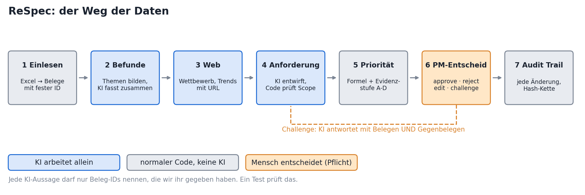
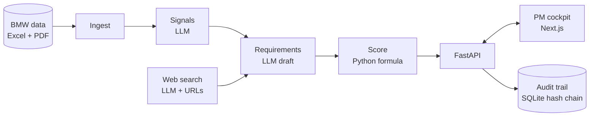

# ReSpec

> **Respect the voice. Define the spec.**

> **From thousands of customer voices to a prioritized, evidence-backed requirement list for the next BMW, with the product manager in control of every decision and every change on a tamper-evident audit trail.**

Built at the TUM.ai × EHL Grand Finale 2026 for the **BMW Group challenge "AI for Product Decision Making"**.
Demo case: **BMW 5 Series (G60), USA**. Transferability shown with **BMW 1 Series (F70), Europe**.

Six model/market snapshots are available. G60-US has 19 requirements; F70-EU has 20.
Thin-data scenarios have fewer proposals and explicitly show their missing sources.
The technical verification and remaining gaps are recorded in [docs/REPO_CHECK.md](docs/REPO_CHECK.md).


*The cockpit in demo mode (G60-US): 3,610 customer comments → 58 findings → 19 ranked requirements, every one open for the PM to approve, reject, edit or challenge.*

**Quickstart (3 commands, no API key needed, uses the shipped snapshots):**

```bash
pip install -r requirements.txt
DEMO_MODUS=true uvicorn main:app --app-dir src/backend --port 8000     # terminal 1 (PowerShell: $env:DEMO_MODUS="true" first)
cd src/frontend && npm ci && npm run build && npm run start            # terminal 2 → http://localhost:3000
```

> **Team:** new here? Start with [START_HIER.md](START_HIER.md) (German, one page).

## What it does

| Step | What happens | AI autonomous? | Human mandatory? |
|---|---|---|---|
| 1 Ingest | Customer feedback, customer study, sales volumes, option list → uniform *evidence* with stable IDs | code, no LLM | – |
| 2 Signals | Evidence → recurring complaints, unmet needs, delights (BMW taxonomy pre-grouping + LLM summary, citing evidence IDs) | yes | – |
| 3 Web | Competitor advantages and 3-5-year trends with URL, date and trust level | yes | – |
| 4 Requirements | Signals → customer-facing, measurable requirements with assumptions and uncertainties | proposes | **every requirement starts as `proposed`** |
| 5 Prioritization | Transparent weighted formula (customer pain, reach × 2030 sales, satisfaction gap, competitive pressure, future relevance, effort) × evidence confidence | formula, no LLM | PM may change weights (logged) |
| 6 Decision | approve · reject · edit · challenge (AI answers with evidence **and** counter-evidence) | answers challenges | **only the PM changes status; rationale required** |
| 7 Audit | Every change: who/what, when, why, before/after; SHA-256 hash chain + `verify` | automatic | – |

## Why it is different

1. **Evidence vs. assumption is explicit:** rule-based evidence level **A-D** per requirement, assumptions listed separately.
2. **Conflicting evidence is surfaced, not averaged** (e.g. "large display praised" vs. "touch-only controls distract").
3. **"Already offered?" check** against the official option list: sometimes the right requirement is a package, not a new feature.
4. **Explainable priority:** every score is a visible waterfall of factors; weights are adjustable live and audited.
5. **Adaptable:** a new vehicle or market is one JSON file in `config/scenarios/`.

## Challenge alignment

| Brief asks for | Where |
|---|---|
| Ingest provided data + enrich from the web | `src/backend/evidence_internal/`, `src/backend/evidence_external/` |
| Signals linked to sources | `Signal.evidence_ids` in `src/backend/core/models.py` |
| Clear, actionable, customer-facing requirements | `src/backend/requirements_engine/derive.py` |
| Prioritization logic you can explain | `src/backend/requirements_engine/scoring.py`, `evidence_level.py` |
| PM approves, rejects, edits, challenges | `POST /api/requirements/{id}/decision` in `src/backend/api/routes.py` |
| Complete audit trail | `src/backend/core/audit.py` (append-only, hash chain, `GET /api/audit/verify`) |
| Structured requirement list | `GET /api/scenarios/{id}/export` (CSV) |

## Key code

Five places carry the product logic (excerpts, line numbers refer to `HEAD`):

**1. Score formula** (`src/backend/requirements_engine/scoring.py:50-70`): weighted factors, then scaled by
how strong the evidence is. Not an LLM, so the same inputs always give the same rank.

```python
for name, weight in w.items():
    value = min(max(factor_values.get(name, 0.0), 0.0), 1.0)
    breakdown[name] = ScoreFactor(value=round(value, 3), weight=round(weight, 3),
                                  contribution=round(value * weight * 100, 1), ...)
raw = sum(f.contribution for f in breakdown.values())
return round(raw * CONFIDENCE[evidence_level], 1), breakdown
```

**2. Tamper-evident audit trail** (`src/backend/core/audit.py:46-49` and `122-141`): every event stores the
hash of its predecessor; `verify()` recomputes the whole chain and reports the first broken row.

```python
canonical = json.dumps(fields, sort_keys=True, ensure_ascii=False, default=str)
return hashlib.sha256(canonical.encode("utf-8")).hexdigest()
...
if row["prev_hash"] != prev_hash or _hash_event(fields) != row["hash"]:
    return {"valid": False, "broken_at_seq": row["seq"], "checked": len(rows)}
```

**3. Hallucination guard** (`src/backend/requirements_engine/derive.py:77`): the LLM may only cite signal IDs
that were part of its input block; invented IDs are dropped, drafts without any valid ID are discarded.

```python
ids = [i for i in dict.fromkeys(draft.signal_ids) if i in known]
```

**4. One door to the LLM** (`src/backend/core/llm.py:48-63`): every call is cached by (model, prompt, schema).
With `DEMO_MODUS=true` there is never a network call; a missing cache entry is a clear error, not a guess.

```python
for kandidat in (path, _cache_path(*anfrage, ordner=DEMO_CACHE_DIR)):
    cached = _read_cache(kandidat, schema)
    if cached is not None:
        return cached
if os.getenv("DEMO_MODUS", "false").lower() == "true":
    raise RuntimeError(f"DEMO_MODUS: kein Cache-Eintrag für {schema.__name__} ({path.name}).")
```

**5. Human decides** (`src/backend/api/routes.py`, `POST /api/requirements/{id}/decision`): only the PM
changes a requirement's status, a rationale is mandatory, and the change is appended to the audit chain.

## Architecture





Details and design decisions: [docs/ARCHITEKTUR.md](docs/ARCHITEKTUR.md). API: [src/shared/API.md](src/shared/API.md).

## Run it

```bash
python -m venv .venv
.venv\Scripts\activate            # macOS/Linux: source .venv/bin/activate
pip install -r requirements.txt
cp .env.example .env              # add your OPENAI_API_KEY (only needed for the pipeline)

# Without BMW data: the backend serves a synthetic example scenario
uvicorn main:app --app-dir src/backend --reload --port 8000     # http://localhost:8000/docs

# Regenerate with the supplied BMW data and an OpenAI key:
python src/backend/pipeline.py --scenario G60-US

python -m pytest -q               # tests
python scripts/verify_stack.py    # six-scenario offline API/PM/restart check; temporary audit DB
```

## Data & privacy

The repository includes the supplied BMW raw data (`data/raw/`), the processed snapshots and the LLM
cache (`data/cache/`, `data/demo_cache/`). We use the BMW data here because the hackathon organisers
supplied it for this challenge and the team's lead decided to publish it in this repository.
Examples in `src/shared/beispiele/` are **synthetic**. API keys (`.env`) and PM audit databases
(`data/audit.db`) stay local; see [data/README.md](data/README.md). The generated data folders are
marked `export-ignore` in `.gitattributes`, so a `git archive` download contains only code and docs;
the full demo runs from a git clone.
`DEMO_MODUS=true` serves the snapshots without network calls, with rule-based challenge and lens
fallbacks when a response is not cached. Regenerating the entire pipeline offline requires caches
for the exact current prompts; the provided cache does not cover all six scenarios.

Run the cockpit with `cd src/frontend`, `npm ci`, `npm run build`, then `npm run start`.
Its API URL defaults to `http://localhost:8000`; set `NEXT_PUBLIC_API_URL` before building if needed.

To add a model/market, copy a config in `config/scenarios/` (or use `scripts/new_scenario.py`),
check its countries, study column, source files and competitors, then run the pipeline for its ID.
Missing upstream stage files produce an error instead of mixing in synthetic scenario data.
New audit databases record the bundle fingerprint. After regenerating a bundle, review it with a
separate `AUDIT_DB`; replay refuses a changed snapshot so old approvals cannot silently apply to new content.

## Team

Four people: Piyush (lead and external evidence), Aditya (internal evidence and evaluation),
Dennis (requirements and prioritization), Lasse (PM cockpit).
Built with Claude Code; sessions recorded with Entire.
