# ReSpec

**Respect the voice. Define the spec.**

ReSpec reads thousands of customer comments about a BMW and turns them into a ranked list of
requirements for the next model. Every requirement links back to the customers who said it.
The AI drafts. A product manager decides. Every decision is logged.

We built it in 24 hours at the TUM.ai × EHL Grand Finale 2026 for the BMW Group challenge
*"AI for Product Decision Making"*.

[](https://github.com/PiyushPapaya/TUMHackathon26/actions/workflows/ci.yml)


---

## Why we built this

BMW gave us the raw material a product manager actually works with: 3,610 customer comments on
the 5 Series in the US, a customer satisfaction study, sales forecasts up to 2030 and the
official option list. The question behind it is simple. **What does the next 5 Series need to do
better, and how sure are we?**

Answering that by hand means reading for weeks. You end up with a slide that says "customers
want better climate controls", and nobody can tell anymore whether that came from 300 people or
from three loud ones. We have all seen decisions like that get made on gut feeling.

So we set ourselves three rules:

1. **Every claim has to point to real customers.** If the AI cannot cite a comment, the claim is gone.
2. **The ranking has to be explainable in one sentence.** No black box score. Plain math you can redo.
3. **A human makes the call.** The AI proposes. Only the PM approves, rejects or edits, and has to say why.

ReSpec is what came out of that.

---

## How it works

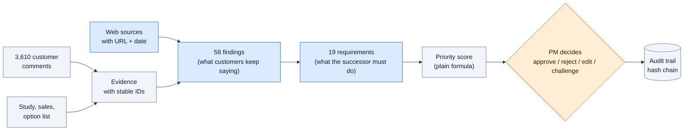

Blue is where the AI works, grey is plain code, orange is where a person decides.
The numbers are the real ones for the BMW 5 Series (G60) in the US.

| Step | What happens | Who does it |
|---|---|---|
| 1. Read | Comments, study, sales and option list become *evidence*, each with a stable ID | Code |
| 2. Find patterns | Evidence is grouped into *findings*: complaints, unmet needs, things people love | AI, citing evidence IDs |
| 3. Check outside | Competitor strengths and trends from the web, each with URL, date and a trust level | AI + rules |
| 4. Write requirements | Findings become customer-facing, measurable requirements with assumptions | AI drafts, all start as `proposed` |
| 5. Rank | Weighted formula: customer pain, reach, satisfaction gap, competition, future relevance, effort | Python, no AI |
| 6. Decide | Approve, reject, edit or challenge. A reason is required | **Only the PM** |
| 7. Log | Every change is stored with who, when, why, before and after, in a SHA-256 hash chain | Code |

---

## A tour through the product

### 1. The ranked list

The cockpit shows what the successor should do better, ranked by customer evidence.
The traffic light next to each row tells you in one glance how solid it is:
green is proven, yellow is weak, red is an assumption.

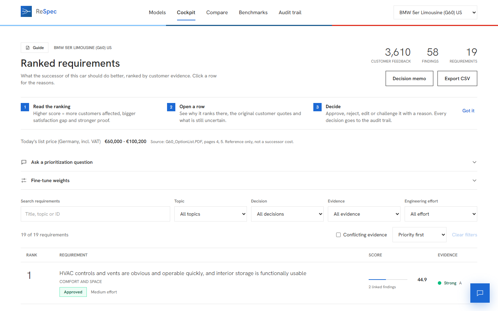

### 2. Ask in your own words

A PM rarely thinks in weights. They think "what matters for families who do road trips?".
You type the question, the AI translates it into weights and topics, and Python re-ranks.
The AI never picks requirements itself, so it cannot invent one. If you like the result,
"Apply" saves it, and your question becomes the reason in the audit trail.

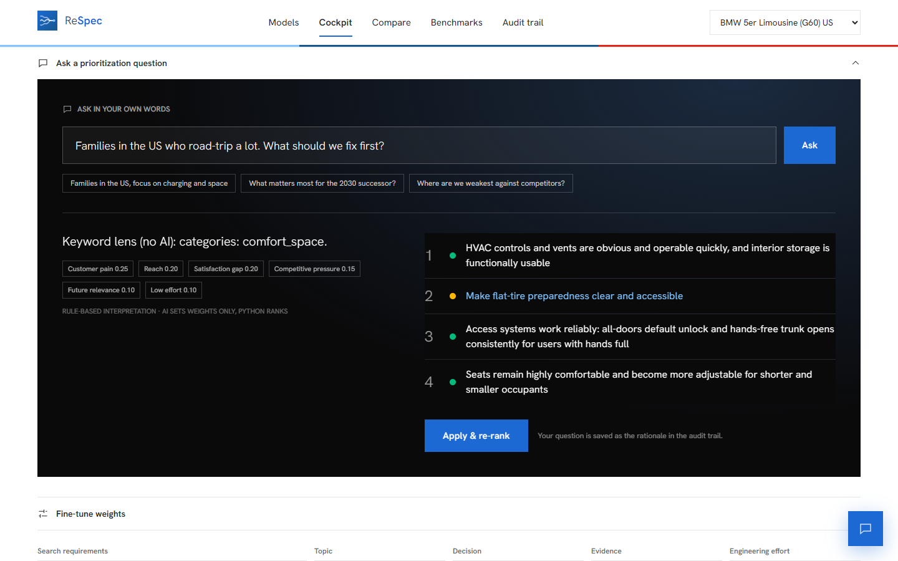

You can also move the sliders yourself. Nothing is saved until you press *Apply weights*.

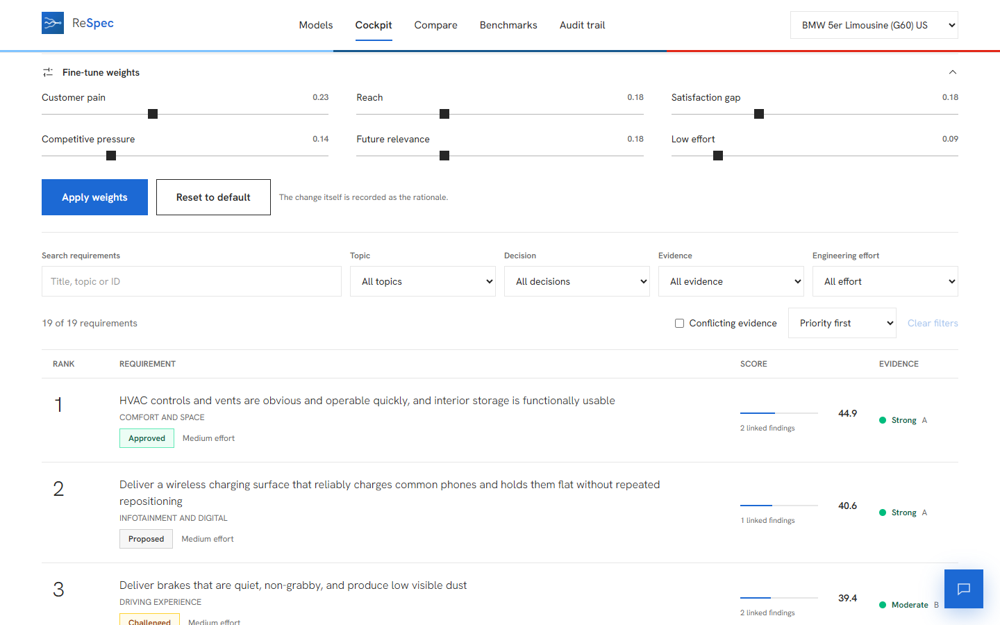

### 3. Why is this ranked here?

Click a requirement and the score breaks down into its parts. Each bar is one factor,
each factor has a "calculation details" link. At the bottom you see how much the score
was discounted for weak evidence. You can redo the math on paper.

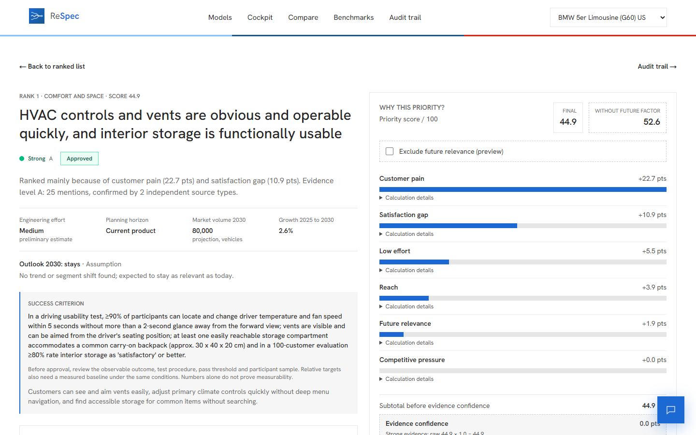

### 4. What customers said, and what we don't know

Below the score you find the findings behind it, an "already offered?" check against the
official option list, and the assumptions written out. Sometimes the answer is "this already
exists as an option, customers just don't know". That is a very different decision than
building something new.

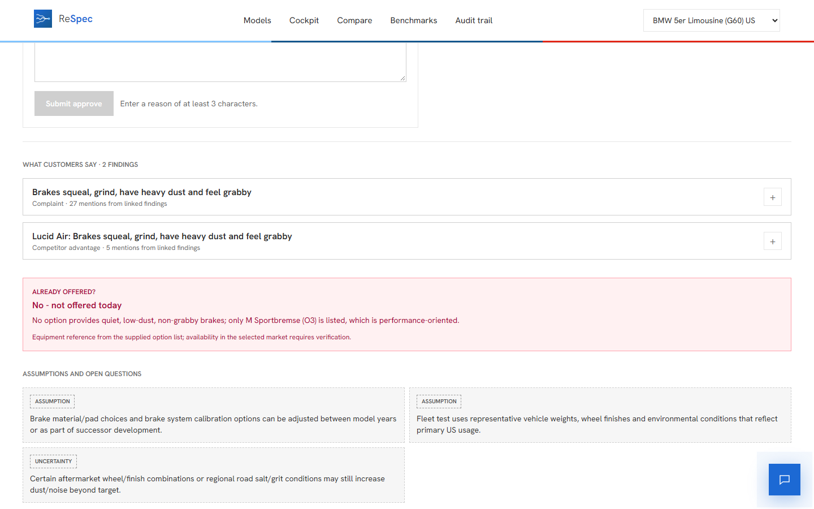

### 5. Challenge the AI

Not convinced? Hit *Challenge* and ask. The AI has to answer with supporting **and**
counter-evidence, and both are clickable IDs. If there is no counter-evidence, it says so.

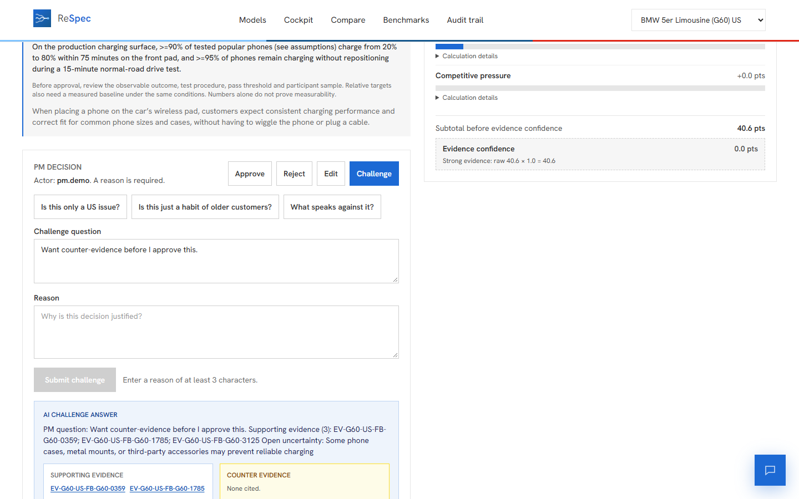

### 6. The audit trail

Every AI proposal and every PM decision lands here, in order, with its reason.
Each entry carries the hash of the one before it. Change anything later and the
check at the top turns red.

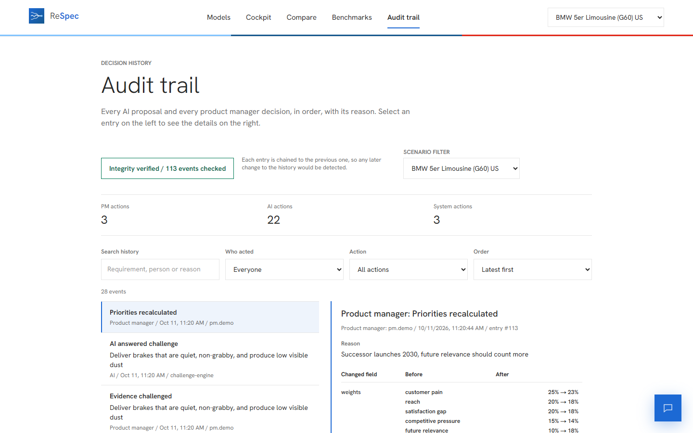

### 7. Honest about uncertainty

The insights page splits requirements into "evidence today" and "bet on the successor",
and has a tab called **What we do not know**. It lists the weakly backed requirements
and the study that would settle each one.

| Evidence vs. assumption | What we do not know |
|---|---|
| 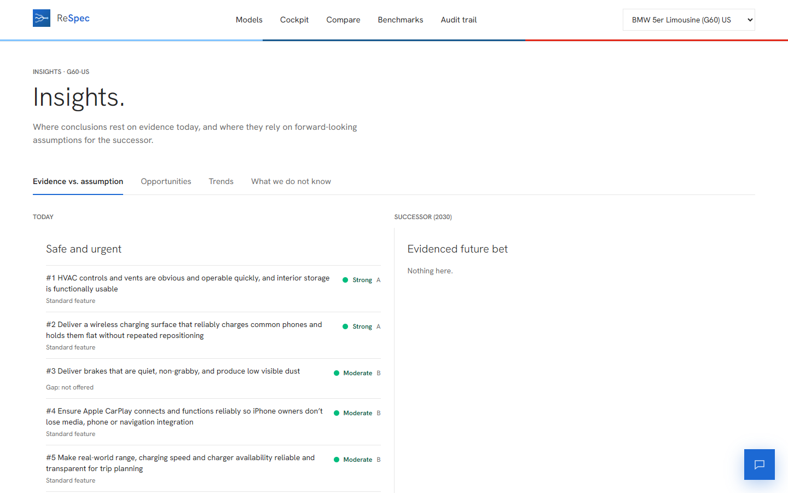 | 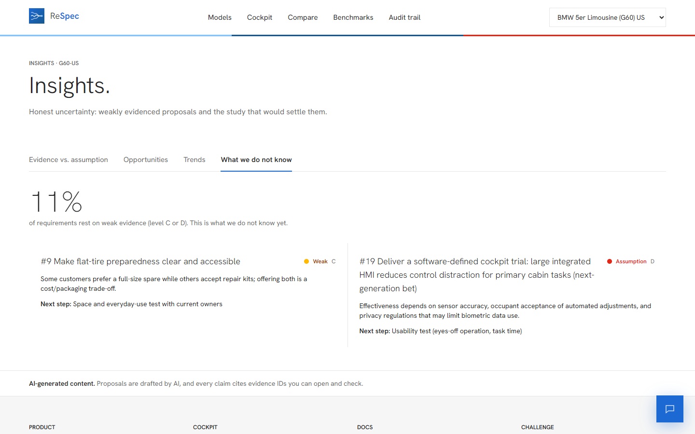 |

### 8. Six models and markets, one pipeline

The same pipeline runs for six model/market combinations. Adding one is a JSON file in
`config/scenarios/`, not new code. Thin data stays thin: G68-CN has no customer comments,
so it shows fewer proposals and says why, instead of filling the list with guesses.

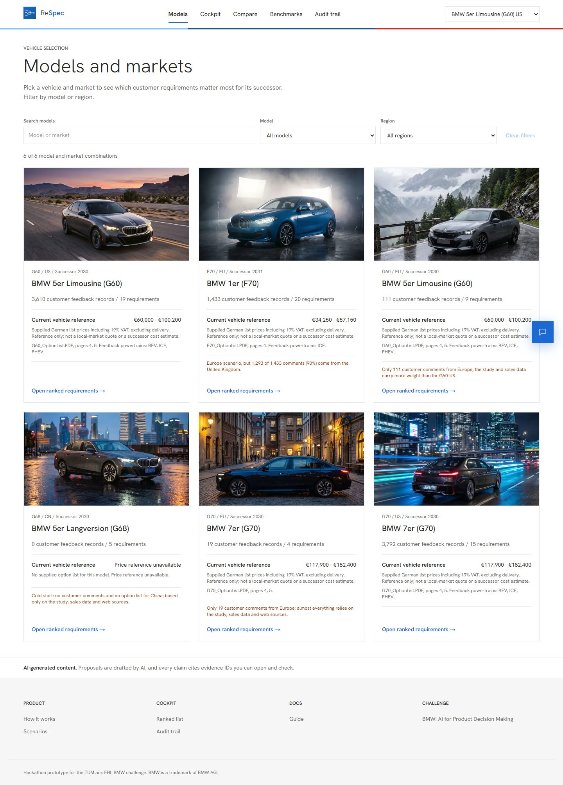

---

## Can you trust it?

We measure this instead of claiming it. The *Benchmarks* page recomputes these numbers every time
it opens, without any AI involved.

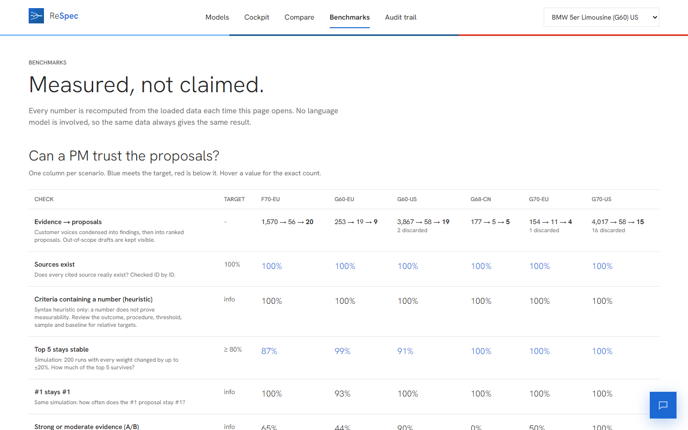

| Scenario | Evidence → findings → requirements | Cited sources exist | Quotes match the original file word for word | Top 5 stays stable (±20 % weights) |
|---|---|---|---|---|
| G60-US (5 Series, US) | 3,867 → 58 → 19 | 100 % | 100 % | 91 % |
| F70-EU (1 Series, EU) | 1,570 → 56 → 20 | 100 % | 100 % | 87 % |
| G70-US (7 Series, US) | 4,017 → 58 → 15 | 100 % | 100 % | 100 % |
| G60-EU (5 Series, EU) | 253 → 19 → 9 | 100 % | 100 % | 99 % |
| G70-EU (7 Series, EU) | 154 → 11 → 4 | 100 % | no comments quoted | 100 % |
| G68-CN (5 Series LWB, China) | 177 → 5 → 5 | 100 % | no comments in the data | 100 % |

For G60-US two of us also checked 50 random finding/quote pairs by hand: 88 % of the quotes really
support the finding they are attached to. The method and its limits are in
[docs/EVALUATION.md](docs/EVALUATION.md).

---

## Try it

You need Python 3.12 and Node 20+. No API key needed: demo mode runs on the shipped snapshots.

```bash
pip install -r requirements.txt
DEMO_MODUS=true uvicorn main:app --app-dir src/backend --port 8000
```

In a second terminal:

```bash
cd src/frontend
npm ci && npm run build && npm run start      # open http://localhost:3000
```

On Windows PowerShell, set the variable first with `$env:DEMO_MODUS="true"`.
Or run both at once with `bash scripts/start_demo.sh`. More options, including the online
setup on Render and Vercel, are in [docs/DEPLOY.md](docs/DEPLOY.md).

Run the tests with `python -m pytest -q`.

---

## How it is built

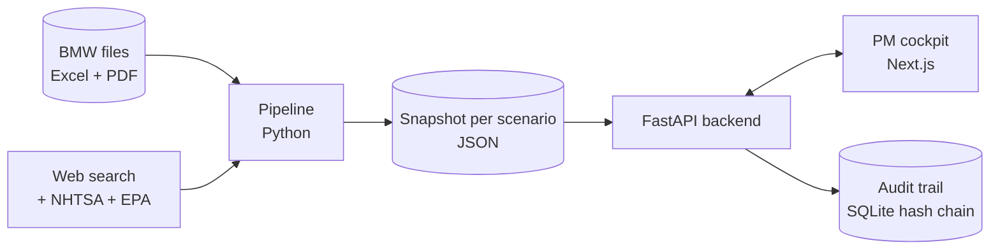

The pipeline runs once per scenario and writes every step to a JSON file. The backend loads
those snapshots, serves ready-made views and records decisions. The frontend only displays:
it does no math, so the screen, the CSV export and the pitch always show the same numbers.

Five places in the code carry the core ideas:

| Idea | Where |
|---|---|
| The score is a formula, not an AI guess | [`requirements_engine/scoring.py`](src/backend/requirements_engine/scoring.py) (lines 61-70) |
| Evidence level A-D follows fixed rules | [`requirements_engine/evidence_level.py`](src/backend/requirements_engine/evidence_level.py) |
| The AI may only cite IDs it was given | [`requirements_engine/derive.py`](src/backend/requirements_engine/derive.py) (line 77) |
| Every AI call goes through one cached door | [`core/llm.py`](src/backend/core/llm.py) (lines 58-63) |
| Tamper-evident audit trail | [`core/audit.py`](src/backend/core/audit.py) (`verify()`, line 138) |

The guard against made-up sources is one line:

```python
ids = [i for i in dict.fromkeys(draft.signal_ids) if i in known]   # drop any ID the AI invented
```

All components, data flow and the design decisions we made (and the ones we dropped) are in
[docs/ARCHITECTURE.md](docs/ARCHITECTURE.md).

---

## Documentation

| If you want to... | Read |
|---|---|
| understand the product as a PM | [docs/product/OVERVIEW.md](docs/product/OVERVIEW.md) |
| use the cockpit step by step | [docs/product/PM_GUIDE.md](docs/product/PM_GUIDE.md) |
| know exactly how the ranking works | [docs/product/PRIORITIZATION.md](docs/product/PRIORITIZATION.md) |
| look up a term | [docs/product/GLOSSARY.md](docs/product/GLOSSARY.md) |
| see how it is built | [docs/ARCHITECTURE.md](docs/ARCHITECTURE.md) |
| check how good the output is | [docs/EVALUATION.md](docs/EVALUATION.md) |
| run it locally or online | [docs/DEPLOY.md](docs/DEPLOY.md) |
| call the API | [src/shared/API.md](src/shared/API.md) |

## Repository map

| Folder | What is in it |
|---|---|
| `src/backend/evidence_internal/` | Reading BMW data, building findings |
| `src/backend/evidence_external/` | Web research, NHTSA complaints, EPA range data, source trust |
| `src/backend/requirements_engine/` | Writing requirements, scoring, evidence levels, challenge answers |
| `src/backend/core/` | Data model, audit trail, store, LLM access, views |
| `src/backend/api/` | REST endpoints |
| `src/frontend/` | The PM cockpit (Next.js) |
| `config/scenarios/` | One JSON file per model and market |
| `data/` | Processed snapshots and caches (no raw BMW files) |
| `tests/` | Backend tests and the evaluation scripts |

## Data and privacy

The confidential BMW raw files are **not** in this repository. The app runs from the processed
snapshots in `data/processed/` and the cached AI answers. Without the raw files, only the list-price
reference from the option list shows "unavailable". API keys stay in `.env`, decisions stay in
your local `data/audit.db`. Details in [data/README.md](data/README.md).

## What it does not do (yet)

- There is no login. The person deciding types their name. In production that would come from SSO.
- One backend process per audit database. It is a prototype, not a multi-user server.
- The 88 % quote check was done with AI suggestions that humans reviewed, not blind labeling.
- Thin scenarios (G68-CN, G70-EU) are honest but not very useful yet. They need more data, not more AI.

## Team

Piyush (lead, integration, web evidence), Aditya (internal evidence, evaluation),
Dennis (requirements and prioritization), Lasse (PM cockpit).
Built with Claude Code, sessions recorded with Entire.
