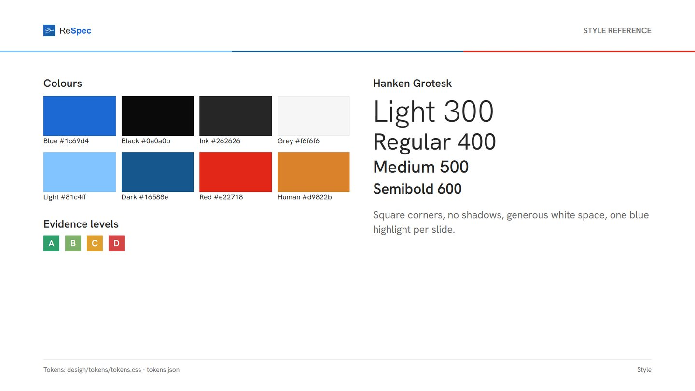
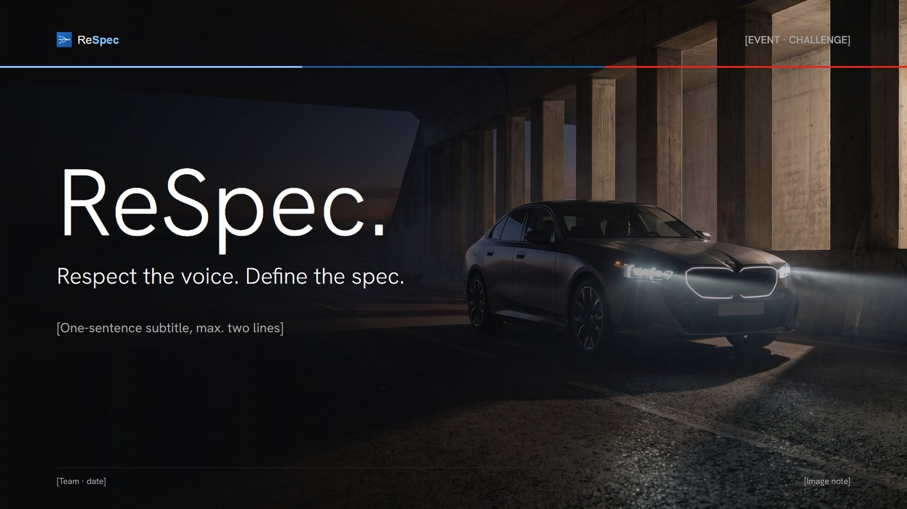
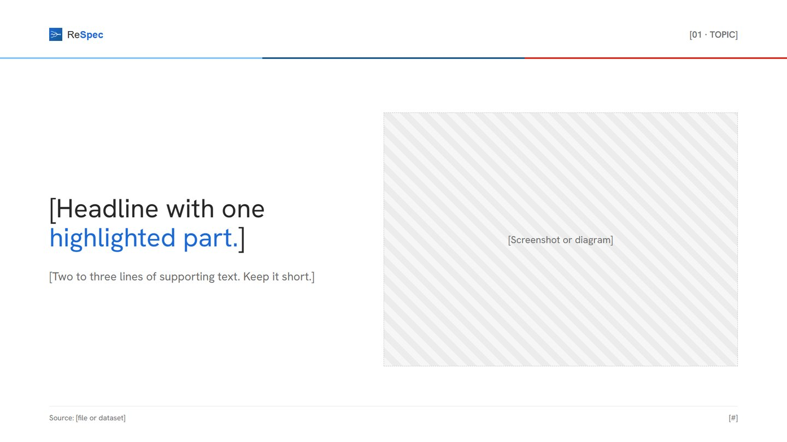
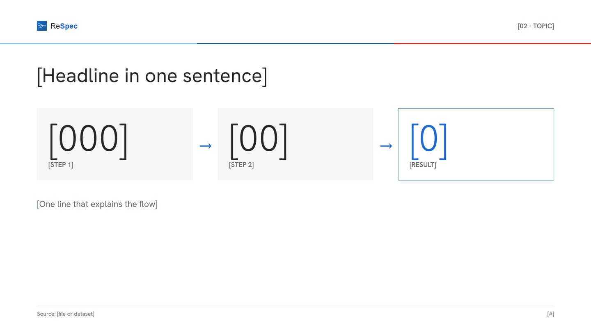
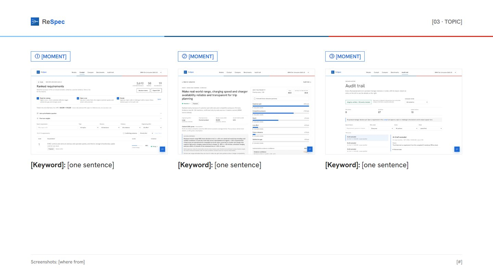
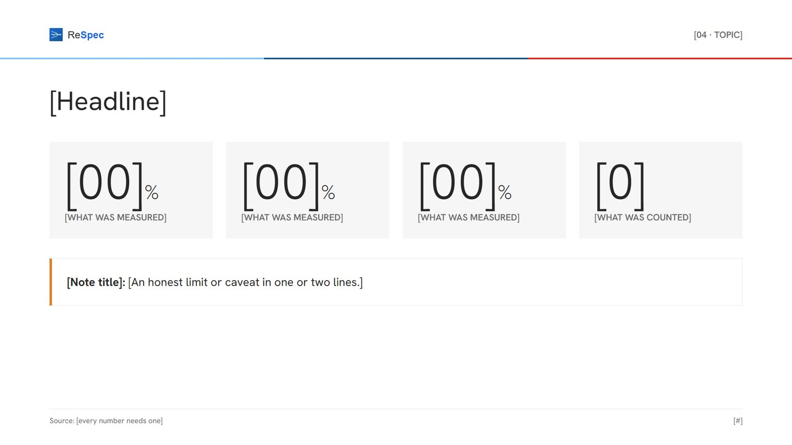
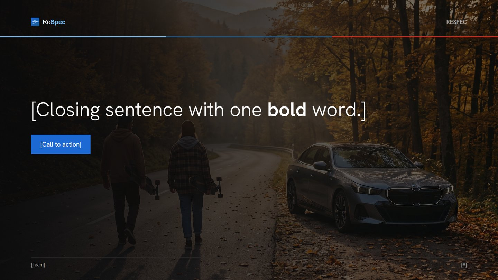

# design/ · ReSpec Design-System

Ein Ort für Logo, Farben, Schrift, Bilder und Folien-Layouts. Wer braucht das: **Lasse** baut damit das
Pitch-Deck, alle anderen nehmen es für Bilder, Doku und Social-Posts. Die Werte sind **dieselben wie in der
App** (`src/frontend/app/globals.css`), damit Deck, Website und Demo wie aus einem Guss aussehen.

> **Wichtig, Marke:** Das **BMW-Logo und die BMW-Hausschrift „BMW Type Next“ verwenden wir nicht.** Die
> Schrift ist lizenziert, das Logo ist eine geschützte Marke, und Auftrag T2 verbietet den Nachbau. Unser Stil
> ist „BMW-nah“: BMW-Blau, die drei Streifen, eckige Formen, viel Weiß. Logo und Name sind unsere eigenen (**ReSpec**).

## Ordner

| Ordner | Inhalt |
|---|---|
| `logo/` | `respec-logo.svg` (helle Flächen), `respec-logo-white.svg` (dunkle Flächen, Fotos), `respec-mark.svg` (nur Zeichen, Favicon/Avatar) |
| `tokens/` | `tokens.css` (für HTML-Folien), `tokens.json` (für Figma, Canva, PowerPoint) |
| `layouts/` | `slide-layouts.html` + `.css`: 10 leere Folien-Layouts + 1 Stil-Übersicht, 16:9 (1920 × 1080). `ReSpec_Slide_Layouts.pdf` zum Ansehen |
| `previews/` | Vorschaubild jedes Layouts (`L01` bis `L11`) |
| `assets/images/` | Auto-Bilder der Website (Titel `poster.jpg`, `split.jpg`, je Szenario `scenario-*.jpg`) |
| `assets/screens/` | Echte Screenshots der laufenden App, Demo-Modus, G60-US, 2× Auflösung (Startseite, Modelle, Cockpit, Detail Rang 1, Detail Rang 5 mit Konflikt, Prüfpfad; `-full` = ganze Seite) |
| `assets/diagrams/` | Datenfluss in 7 Schritten (`techflow`), Zitat → Entscheidung (`zitat_zu_requirement`), PNG + SVG |
| `assets/charts/` | Charts aus echten BMW-Daten (Kritik-Themen, Feedback-Typen, Studie, Absatz) |

## Farben

| Rolle | Name | Hex | Wofür |
|---|---|---|---|
| Marke | Blau | `#1c69d4` | Hervorhebung, Buttons, Score-Balken. **Ein** blauer Akzent pro Folie |
| Marke | Blau Hover | `#0653b6` | Links/Buttons im Hover |
| Streifen | Hellblau · Dunkelblau · Rot | `#81c4ff` · `#16588e` · `#e22718` | Nur die drei Streifen unter dem Kopf, nie als Flächenfarbe |
| Neutral | Schwarz | `#0a0a0b` | Titel- und Abschlussfolie |
| Neutral | Ink | `#262626` | Fließtext |
| Neutral | Grau 500 | `#6b6b6b` | Nebentext, Quellen |
| Neutral | Grau 100 · Linie | `#f6f6f6` · `#e6e6e6` | Karten, Trennlinien |
| Bedeutung | KI · Code · Mensch | `#1c69d4` · `#7b8594` · `#d9822b` | Wer macht einen Schritt (wie im Datenfluss-Bild) |
| Evidenz | A · B · C · D | `#2e9e6b` · `#7fb069` · `#e0a030` · `#d64545` | Evidenzstufen-Chips |

## Schrift

**Hanken Grotesk** (Google Fonts, SIL Open Font License, frei nutzbar), dieselbe wie in der App. Sie ist der
freie, ähnlich geometrische Ersatz für die proprietäre BMW Type Next (siehe `src/frontend/app/layout.tsx`).
Laden: `https://fonts.google.com/specimen/Hanken+Grotesk`. In PowerPoint/Keynote vorher installieren.

| Ebene | Größe (bei 1920 px) | Schnitt |
|---|---|---|
| Display (Titel „ReSpec.“) | 200 px | Light 300 |
| H1 / Abschnitt | 84-120 px | Light 300 |
| H2 / Folien-Headline | 52-64 px | Regular 400 |
| H3 / Kartentitel | 30 px | Semibold 600 |
| Fließtext | 28 px | Regular 400 |
| Eyebrow, Label (GROSS) | 20-22 px | Semibold 600 |
| Fußzeile, Quelle | 18 px | Regular 400 |

## Regeln (kurz)

1. **Eckig, ohne Schatten:** Radius 0, keine Schlagschatten, genau wie in der App.
2. **Rahmen jeder Folie:** Logo oben links, Eyebrow oben rechts, drei Streifen, Fußzeile mit **Quelle** und Seitenzahl.
3. **Jede Zahl hat eine Quelle** in der Fußzeile (Code, `tests/eval/REPORT.md` oder `data/processed/`).
4. **Ränder 120 px links/rechts**, viel Weißraum, höchstens eine Hauptaussage pro Folie.
5. **Dunkle Folien** (Titel, Abschnitt, Abschluss) liegen auf einem Foto mit Verlauf von links; dort das weiße Logo.
6. **Bilder:** Die Auto-Bilder sind mit KI erzeugt (Google Flow, `visuals/flow-prompts.md`), kein BMW-Pressematerial.
   Einmal im Deck vermerken. Screenshots immer mit 1 px Linie `#e6e6e6`.

## Layouts

| | Layout | Wofür |
|---|---|---|
| L01 | Titel (dunkel, Foto) | Erste Folie |
| L02 | Abschnitt (dunkel) | Trenner, z. B. vor dem Anhang |
| L03 | Aussage + Bild | Problem, Lösung |
| L04 | Ablauf / Trichter | 3 Schritte mit großen Zahlen |
| L05 | Drei Screenshots | Demo-Momente |
| L06 | Kennzahlen + Hinweis | Ergebnisse + ehrliche Grenze |
| L07 | Vier Karten | Vergleiche, Grenzen, Architektur |
| L08 | Breites Diagramm + Legende | Workflow KI vs. Mensch |
| L09 | Zitat | Kundenstimme mit Beleg-ID |
| L10 | Abschluss (dunkel) | Kernsatz |
| L11 | Stil-Übersicht | Nur Referenz, nicht ins Deck |

## So benutzt du es

- **HTML-Deck:** `layouts/slide-layouts.html` kopieren, Abschnitte (`<section class="slide">`) behalten,
  `[Platzhalter]` ersetzen. Im Browser öffnen, **Drucken → Als PDF speichern**, Ränder „Keine“, Hintergrundgrafiken an.
- **Canva/PowerPoint/Figma:** Farben aus `tokens/tokens.json`, Schrift Hanken Grotesk, Logo als SVG, die
  Vorschaubilder in `previews/` als Vorlage zum Nachbauen.
- **Neue Screenshots:** Backend mit `DEMO_MODUS=true`, Frontend starten, Fenster 1440 × 900 bei 2× Zoom.

Dieser Ordner steht in `.gitattributes` als `export-ignore`: Er ist auf GitHub sichtbar, belastet aber das
Lese-Budget der Jury-KI nicht.
