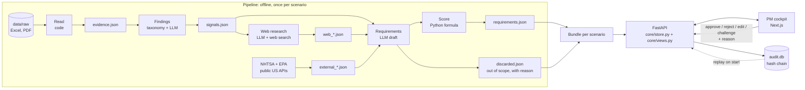

# Architecture

Everyone on the team should be able to explain this page to a jury. So it is written plainly.
If you change components or data flow, update this file in the same commit.

## In two sentences

A Python **pipeline** condenses BMW data and web sources step by step into ranked requirements
and saves every intermediate result as JSON. A **FastAPI backend** serves those results, accepts
PM decisions and writes each change into an **audit trail** (SQLite with a hash chain); the
**Next.js cockpit** shows everything.

## Data flow




## Components

### Pipeline: from raw data to requirements

| Component | File | What it does | AI? |
|---|---|---|---|
| Dataset profile | `config/datasets.json`, `core/datasets.py` | Column and sheet names of the BMW files. A new dataset means editing JSON, not code | no |
| Scenarios | `config/scenarios/*.json` | Vehicle × market, source files, competitors | no |
| Read | `evidence_internal/loaders.py` | Feedback and study rows become evidence with stable IDs | no |
| Findings | `evidence_internal/signals.py` | Group by BMW taxonomy, then summarize with the LLM | yes |
| Web questions | `evidence_external/questions.py` | Up to 8 competitor and 5 trend questions, built by rules | no |
| Web research | `evidence_external/web_research.py` | Questions → claims → web evidence (one URL = one piece of evidence) | yes |
| Source trust | `evidence_external/trust.py` | high / medium / low, from the domain alone | no |
| Triangulation | `evidence_external/triangulation.py` | Attaches trusted, supporting web evidence to internal findings | no |
| NHTSA | `evidence_external/nhtsa.py` | US government complaints as a second customer source | no |
| EPA range | `evidence_external/fueleconomy.py` | Official range and consumption for BMW and competitors (US only) | no |
| Requirements | `requirements_engine/derive.py` | LLM drafts requirements, code computes the factors | yes |
| Evidence level | `requirements_engine/evidence_level.py` | Rules for A-D | no |
| Scoring | `requirements_engine/scoring.py` | Weighted formula, discounted by evidence level | no |
| Provenance | `core/provenance.py` | Model, prompt hash and commit of a pipeline run | no |

### Backend: serving and recording

| Component | File | What it does | AI? |
|---|---|---|---|
| Data model | `core/models.py`, `core/model_parts.py` | Contract: Evidence, Signal, Requirement, AuditEvent | no |
| LLM access | `core/llm.py` | The only door to OpenAI: JSON schema, cache, demo mode | yes |
| Store | `core/store.py` | State per scenario, PM actions, re-ranking | no |
| Audit trail | `core/audit.py` | Append-only events, SHA-256 chain, `verify()` | no |
| Replay | `core/replay.py` | Re-applies PM decisions and weights from `audit.db` on start | no |
| Single process | `core/single_process.py` | Allows exactly one API process per `audit.db` | no |
| Views | `core/views.py`, `portfolio.py`, `insights.py` | Ready-made answers per screen: overview, score waterfall, what-if, portfolio, opportunities, trends, gaps | no |
| Benchmarks | `core/benchmarks.py`, `market_benchmarks.py` | Quality checks per scenario, 200-run weight simulation, market comparison | no |
| Outlook | `core/outlook.py` | Rule-based "grows / stays / fades" for the successor, marked as assumption | no |
| Prompt lens | `core/lens.py` | PM question → weights and topics (LLM, or keyword rules) → top 5 in Python | weights only |
| Challenge | `requirements_engine/challenge.py` | Answer with evidence and counter-evidence | yes |
| Decision aids | `core/req_insights.py` | Matrix, market counterpart, decision memo | no |
| API | `api/routes.py`, `api/views.py`, `api/insights_routes.py` | REST endpoints, see `src/shared/API.md` | no |

### Frontend: the PM cockpit

| Screen | Where | What it shows |
|---|---|---|
| Start page | `app/page.tsx`, `components/home/*` | Scroll story with live numbers from the backend, scenario cards |
| Cockpit | `app/cockpit/page.tsx`, `components/cockpit/*` | Ranked list, "ask in your own words", weight sliders, filters |
| Requirement | `app/requirements/[id]/page.tsx`, `DecisionPanel.tsx` | Score waterfall, findings, quotes, assumptions, decision panel |
| Audit trail | `app/audit/page.tsx`, `AuditTrail.tsx` | Chain check and every event in plain sentences |
| Insights | `app/insights/page.tsx`, `components/insights/*` | Evidence vs. assumption, opportunities, trends, what we do not know |
| Benchmarks | `app/benchmarks/page.tsx` | Quality per scenario, BMW vs. competitors |
| Models, Compare, Evidence | `app/models`, `app/portfolio`, `app/evidence` | Scenario picker, cross-market comparison, searchable evidence |
| Assistant | `components/shell/assistant/`, `POST /api/ask` | Rule-based help and data questions, only real requirement IDs |

## Design decisions

Format: what we did, why, and what we dropped.

### Trust: nothing without a source

| Decision | Why | Dropped |
|---|---|---|
| LLM output may only contain IDs from its input. A test checks this | One invented source would destroy trust in the whole list | Free text without sources |
| Evidence level A-D by rule, not by the LLM | The brief asks to separate evidence from assumption clearly | LLM self-rating ("confidence: 0.8") |
| A needs two BMW sources (feedback + study); web lifts at most to B | Almost every topic has some web hit that only touches it | Counting web like BMW data |
| Conflicting evidence is shown, not averaged away | The PM should see both sides | Hiding contradictions |
| Low-trust web evidence stays visible but never joins a finding. Odd URLs (`\`, `user@`, spaces) count as low | The PM sees what was filtered; tricky URLs could pose as a trusted magazine | Deleting low evidence, trusting `urlparse` alone |
| NHTSA complaints get their own findings | A brake complaint must not support a touchscreen finding | Matching by category |
| Missing values stay missing (EPA range, prices, sales) | A guessed number looks exactly like a real one | Estimating |

### Reproducible: same input, same ranking

| Decision | Why | Dropped |
|---|---|---|
| Score by a Python formula, not by the LLM | Reproducible, every point explainable, PM can change weights | LLM ranks (black box, varies per run) |
| Pre-group comments by BMW taxonomy, LLM only summarizes | ~3,600 comments become ~50 LLM calls instead of 3,600 | Embedding clustering (costly, hard to explain) |
| Web questions and source trust by rule | Reproducible and cache-friendly | LLM invents questions and rates sources |
| Pipeline steps saved as JSON files | Four people could work in parallel, each step can be checked, demo needs no waiting | Everything live per request |
| Views as ready-made endpoints, the frontend computes nothing | UI, CSV and pitch show the same numbers; logic is testable without a browser | A second formula in the frontend |
| Every LLM call cached; demo mode never calls the network | The demo runs offline, a missing cache entry is a clear error, not a guess | Live calls during the demo |

### Control: the PM decides

| Decision | Why | Dropped |
|---|---|---|
| Every requirement starts as `proposed`; only the PM changes status, with a reason | The brief asks for human control | AI auto-approves strong items |
| Prompt lens: the LLM picks weights and topics, never IDs; Python ranks; "Apply" is a separate step | Nothing can be invented, the rank stays recomputable, the PM keeps control | LLM sorts requirements itself |
| What-if previews save nothing; only `PUT /weights` writes to the audit trail | Trying things should not flood the log | Logging every slider move |
| The lens question becomes the audit reason | The question *is* the reason; no extra typing | A separate reason field |
| Assistant is rule-based plus `/api/ask`, not a free chat | Answers about the product are fixed and checkable | Free LLM chat (could make things up) |

### Audit trail

| Decision | Why | Dropped |
|---|---|---|
| Append-only SQLite with SHA-256 hash chain | Tampering is detectable, one file, no server | Plain log file, blockchain |
| Decisions restored by replay from `audit.db` | One single source of truth after restart | A second status file |
| Lock around the SQLite connection | Parallel requests once produced two events with the same predecessor hash | One connection per request |
| New audit DBs store the bundle fingerprint; replay refuses a changed snapshot | Old approvals must not silently apply to new content | Replaying anyway |
| No login in the prototype; `actor` is self-declared | Login was out of scope for 24 h. The chain protects history, not identity. In production: SSO | Fake login |
| CSV export defuses cells starting with `= + - @` | Some text comes from the LLM or the web; Excel would run it as a formula | Raw export |

### Product and frontend

| Decision | Why | Dropped |
|---|---|---|
| A new vehicle or market is one JSON file | Brief: "adaptable to other BMW vehicles and markets" | Special code per model |
| Price only as today's German list price from the supplied option list, with page numbers | A real, checkable number; no cost guess for the successor | Estimated development cost |
| Evidence as a traffic light: A+B green, C yellow, D red | A PM sees in one second whether something is backed | Four colors for A-D |
| Navigation reduced to the demo flow; side pages stay reachable by URL | One clear path: ask, see the list move, check evidence, decide, check the log | Everything in the menu |
| Scenario lives in the URL (`?scenario=`) | Header, cockpit and deep links share one state without a state library | Global state, localStorage |
| GSAP and Lenis only on the start page, loaded on demand | The cockpit stays light; reduced motion turns effects off | Load globally |
| Clean look: light, square corners, one accent color, no BMW logos | Calm and readable; own logo instead of brand assets | Default dashboard style |

### Operations and data

| Decision | Why | Dropped |
|---|---|---|
| Raw BMW files are **not** in the repo (since Oct 11); processed snapshots and caches are | The raw files are confidential challenge material; the app runs fully from snapshots | Shipping the Excel files |
| Exactly one API process per `audit.db`, enforced by an OS file lock | The store keeps PM state in memory; a second worker would show stale state | Reloading from DB on each request |
| Online: UI on Vercel, backend as one long-running process on Render | The in-memory store and `audit.db` need a process that stays alive | FastAPI as a serverless function |
| Provenance (model, prompt hash, commit) in each new bundle and in the audit trail | You can see which model and prompt produced the proposals | Labeling old bundles after the fact |
| `--scenario all`: a failure stops only that scenario | A six-scenario overnight run should not die on one timeout | Continuing with fallback data |
| Outlook for the successor by rule, kept out of the score | Otherwise ranks would shift on an assumption | LLM estimate |

## External services

| Service | Used for | Without network |
|---|---|---|
| OpenAI Responses API | Findings, requirements, challenge answers | `data/cache/`, `data/demo_cache/`, `DEMO_MODUS=true` |
| OpenAI web search tool | External evidence with URL | `data/demo_cache/` |
| NHTSA Complaints API (no key, public domain) | US customer complaints for BMW and competitors | `data/external_cache/nhtsa/` |
| fueleconomy.gov (EPA, no key) | Official range of competitors | `data/external_cache/fueleconomy/` |

## Run

```bash
python -m venv .venv && source .venv/bin/activate     # Windows: .venv\Scripts\activate
pip install -r requirements.txt
python src/backend/pipeline.py --scenario G60-US       # needs data/raw/ + OPENAI_API_KEY
python src/backend/pipeline.py --scenario all          # all six scenarios
uvicorn main:app --app-dir src/backend --reload --port 8000
python -m pytest -q
```
