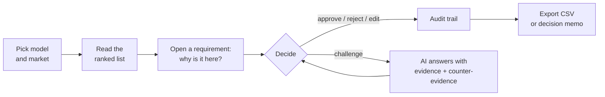

# ReSpec for product managers

This page is for people who decide what goes into a car, not for people who write code.

## The job we are trying to help with

Picture a product manager at BMW planning the successor of the 5 Series. It launches around 2030.
On their desk:

- **3,610 customer comments** from the US alone, from four different feedback channels
- a **customer satisfaction study** with dozens of questions
- **sales forecasts** per market up to 2030
- the **option list**: what you can already order today
- and whatever competitors and the press are doing

The question is always the same: *what does the next car need to do better, in what order, and how sure are we?*

Today this means weeks of reading, a workshop, and a slide with ten bullet points. By the time it
reaches a steering meeting, nobody remembers which bullet came from 300 customers and which came
from one angry forum post. When someone asks "why is this number 2?", the honest answer is often "it felt right".

## What ReSpec changes

| Before | With ReSpec |
|---|---|
| Weeks of reading comments | The AI reads and groups them, every group cites its comments |
| "Customers want X" without a source | Every requirement links to findings, every finding to real quotes |
| Priority by discussion | Priority by a visible formula you can adjust and defend |
| Evidence and guesses mixed together | Each requirement has a level from A (proven) to D (assumption) |
| Contradictions get averaged away | Conflicts are shown: "BEV owners love it, ICE owners hate it" |
| Decisions in an email thread | Every decision with a reason in a tamper-evident log |

## What the AI does, and what it does not

**The AI does:**
- summarize groups of comments into findings, citing the comment IDs
- search the web for competitor strengths and trends, with URL and date
- draft requirements in customer language with a measurable success criterion
- answer when you challenge a requirement, with supporting and counter-evidence
- translate a question like "what matters for families?" into weights

**The AI does not:**
- rank anything (that is a formula)
- decide the evidence level (that is a rule)
- approve, reject or change a requirement (that is you)
- invent sources (any ID it was not given is thrown away before you see it)

## The workflow in five steps

1. **Pick a model and market.** Six are loaded, from the 1 Series in Europe to the 7 Series in the US.
2. **Read the ranked list.** Score and traffic light per row. Ask a question to re-rank for a specific focus.
3. **Open a requirement.** See the score breakdown, the customer quotes, what is already offered, and the assumptions.
4. **Decide.** Approve, reject, edit or challenge. A reason is always required.
5. **Share.** Export the list as CSV, or a decision memo in Markdown that cites the audit trail.

The step-by-step version with screenshots is in [PM_GUIDE.md](PM_GUIDE.md).

## The six scenarios

| Scenario | Vehicle | Market | Customer comments | Requirements | What it shows |
|---|---|---|---|---|---|
| G60-US | 5 Series Sedan | USA | 3,610 | 19 | Main demo, richest data |
| F70-EU | 1 Series | Europe | 1,433 | 20 | Same pipeline, different car and market |
| G70-US | 7 Series | USA | 3,792 | 15 | Luxury segment |
| G60-EU | 5 Series Sedan | Europe | 111 | 9 | Little data, fewer but honest proposals |
| G70-EU | 7 Series | Europe | 19 | 4 | Almost no comments, rests on the study |
| G68-CN | 5 Series long wheelbase | China | 0 | 5 | Cold start: only study and sales data |

The thin scenarios are not failures. They show what the tool does when the data is not there:
it says so, instead of making a full list out of nothing.

## Things to keep in mind

- **The weights are opinions.** Ours are a starting point. Change them, and the reason is logged.
- **D means assumption.** A D-level requirement can still be the right bet for 2030. It just needs a study first,
  and the *What we do not know* tab tells you which one.
- **The price shown is today's German list price** from the option list. It is a reference, not a cost estimate for the successor.
- **There is no login.** You type your name. In a real deployment this would come from company SSO.
